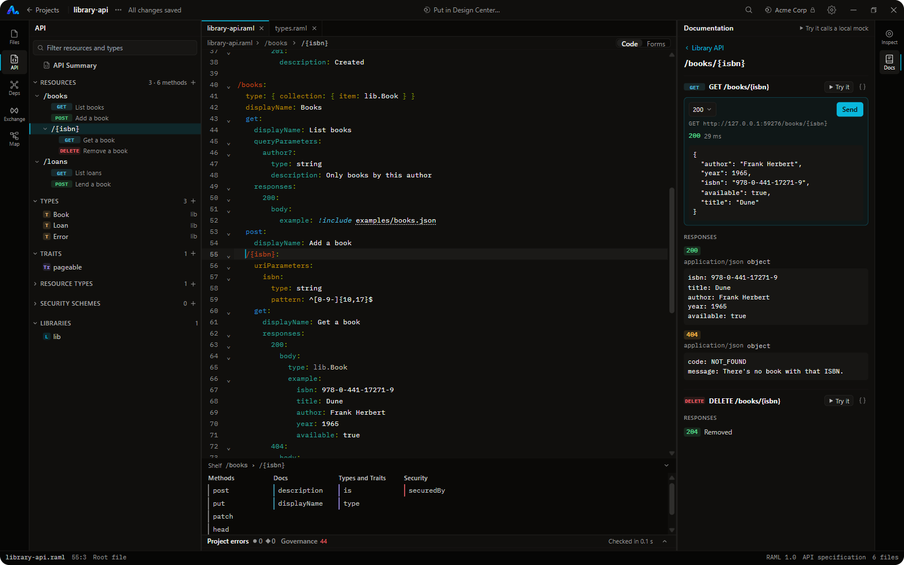
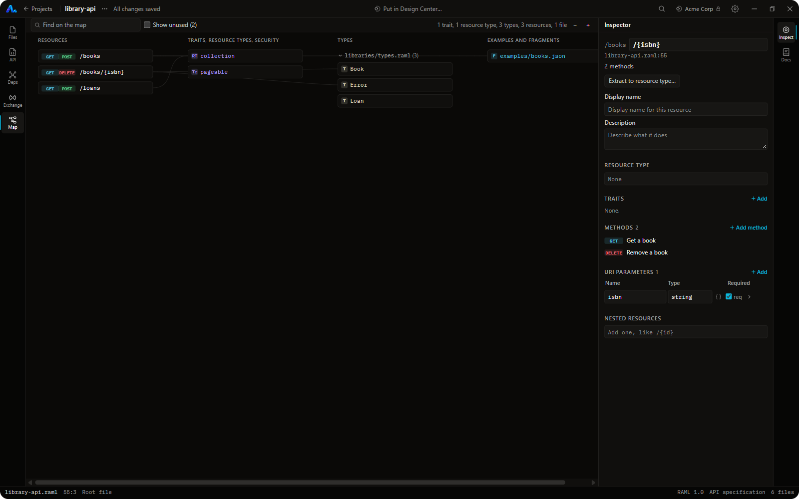
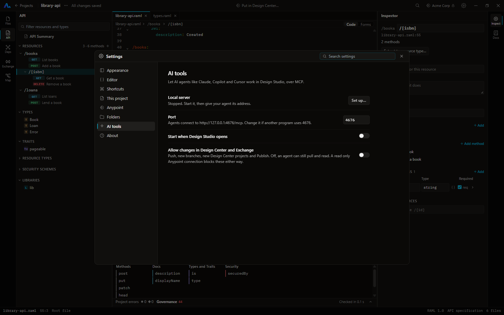
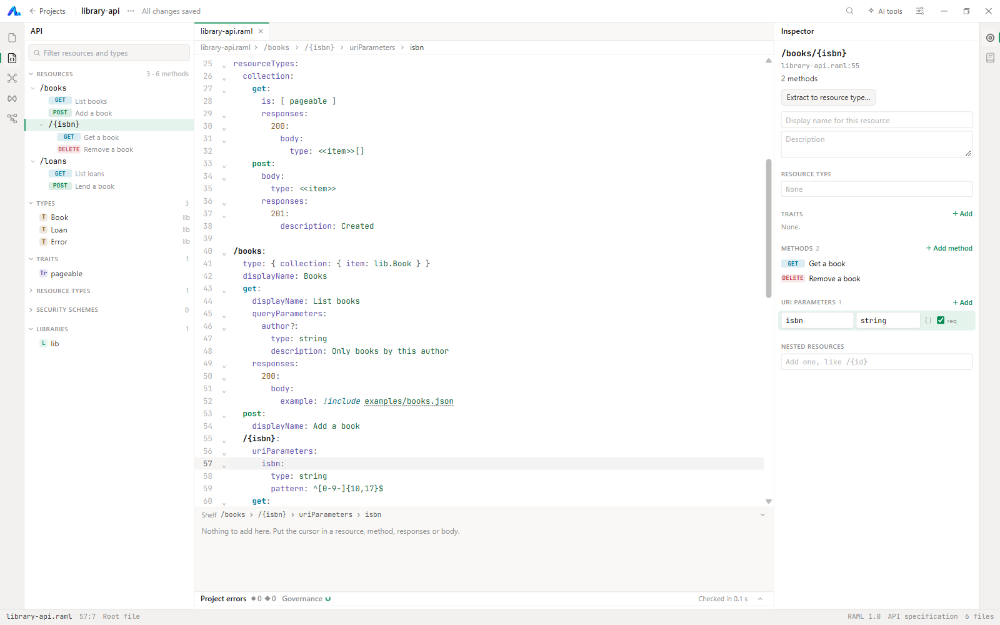

# Design Studio for MuleSoft

A fast designer for Anypoint Design Center API specs, RAML and OAS, as a **desktop app** or a **VS Code extension**. The visual editor and the code stay in step both ways, big specs open in seconds, and every edit is checked as you type by AMF, the engine Design Center itself uses.

> **On a big spec, Design Center's suggestions crawl, so most of us end up copying an endpoint, pasting it and editing by hand. Design Studio makes that fast again: same layout, same words (Root file, Project errors, Exchange dependencies, Publish), the same pull, push and publish, on your own computer.**

Built with Tauri 2 (Rust), React, TypeScript and CodeMirror. It ships with AMF 5.15 and a small Java 17 runtime, so there's nothing else to install.

**[VS Code Marketplace](https://marketplace.visualstudio.com/items?itemName=ashutosh-vijay.design-studio-mulesoft)** | **[Download](https://ashutosh-vijay.dev/design-studio/)** | **[Releases](https://github.com/Ashutosh-Vijay/design-studio/releases)**

> **Beta.** It does real work today; tell us what you hit.

---

## Preview

*The editor with the API tree and the Inspector: forms for the resource under the cursor, written back as the smallest change to the text*

*A type from a library as a form: properties, types, required, and every place it's used, from AMF's own links*

*Documentation for the API as AMF resolves it, and Try it on a local mock that answers with the spec's examples and Design Center's MS2 headers*

*Governance: the rulesets the API depends on (here, Anypoint Best Practices), checked in the background, each finding linked to its line*

*The API map: resources, traits, resource types, types and files, with what uses what, and Show unused*

*AI tools: Claude, Copilot or Cursor can open projects, edit specs and run AMF's checks in the app while you watch*

*API Design Academy: short lessons with a live editor, checked by AMF*

*The same in the Paper (light) theme*

---

## What it does

- **Fast on big specs.** A 2,000-line RAML spec with 40 files opens in seconds. Errors show as you type (a quick read after each edit, AMF's full check in the background), with the same messages as Design Center.
- **Instant suggestions.** Types (library types under their `uses:` alias), traits, resource types and `!include` paths, plus Design Center's shelf under the editor: click and it's inserted at the right indentation.
- **Forms and code in step.** The Inspector edits resources, methods, types, parameters, bodies and responses for RAML 1.0 and OAS 3.0 (YAML and JSON). It changes only the lines it must, so a form edit never rewrites your file.
- **Refactorings.** Rename a type, trait or resource type everywhere, find references, extract to a library, move a type to a library, delete with cascade. Renaming a file updates every `!include` and `uses:`.
- **Design Center sync.** Sign in, list your projects, pull one or all, push with the branch lock, Lock while I edit, branches, and a merge that puts both versions between markers when you and Design Center changed the same lines.
- **Exchange.** Publish with a suggested version (from what changed since the last one), Development or Stable, dependencies added, updated and removed, and Import from Exchange.
- **Governance.** Rulesets from Exchange, checked after every full check, with rules you can switch off per project.
- **Documentation, mock and map.** The API as documentation, Try it on a local mock, and a map of what uses what.
- **Design Center's file actions.** Set as root file, Rename, Duplicate (a copy, or RAML to OAS through AMF), Delete to the trash, Download as zip, Import.
- **AI tools (MCP).** 33 tools for agents, from opening a project to publishing. Changes in Design Center and Exchange stay off until you allow them.
- **API Design Academy.** 16 lessons from "what is an API" to libraries, publishing, governance and OAS.
- **Works offline.** Open a folder or a Design Center zip; you only sign in to pull, push and publish.

## Install

- **VS Code:** install **Design Studio for MuleSoft** from the Marketplace, then run **Design Studio: Open**, or right-click a project folder or a `.raml` file and pick **Open in Design Studio**. Everything is bundled, so it suits locked-down work machines.
- **Windows, macOS, Linux:** download from the [Releases](https://github.com/Ashutosh-Vijay/design-studio/releases) page. Windows has an installer, a portable zip, and the installer zipped for proxies that block `.exe`. The desktop app updates itself quietly.

The builds aren't code-signed yet: on Windows, SmartScreen needs **More info**, then **Run anyway**; on macOS, **System Settings > Privacy & Security > Open Anyway**.

## Signing in to Anypoint

- **Sign in with Anypoint** opens your browser and comes back to this computer. It works in the US and India clouds today; more are coming.
- **Your own Connected App** works in every Anypoint cloud (US, EU, Canada, UK, Japan, India, Australia and US Government), with a browser sign-in or client credentials; its secret goes to the system keychain.
- **Connections start read only.** Nothing in Design Center or Exchange changes until you turn read only off in Settings.

## AI tools

In the VS Code extension, Copilot's agent mode can use Design Studio's tools directly: pick them in its tools list, nothing to set up or start. For other agents (Claude Code, Cursor, Claude Desktop, or Copilot in the desktop app's case), open Settings, AI tools, and **Start**: the panel shows the one-line setup for each. That server listens on `127.0.0.1` only.

## Privacy and security

No telemetry, no analytics, no accounts of its own. Your specs stay on your computer unless you push or publish them to your own Anypoint organization. [PRIVACY.md](PRIVACY.md) is the short version; [SECURITY.md](SECURITY.md) lists every network connection and port, for reviewers.

## Build from source

- **Desktop:** Java 17 or later and Maven, Node 22, Rust. `mvn package` in `amf-server/`, then `npm install` and `npm run tauri dev`.
- **VS Code:** `npm run build:vscode`, then see [vscode-extension/DEVELOPMENT.md](vscode-extension/DEVELOPMENT.md).
- **Releasing:** [docs/RELEASING.md](docs/RELEASING.md).

How it's built is in [docs/ARCHITECTURE.md](docs/ARCHITECTURE.md), and the plan and every proof test in [docs/PLAN.md](docs/PLAN.md).

## Credits

AMF is MuleSoft's, under the Apache License 2.0. Design Studio is not affiliated with, endorsed by or sponsored by MuleSoft or Salesforce. Anypoint, Design Center, Exchange and MuleSoft are trademarks of Salesforce, Inc. See [NOTICE](NOTICE).

Made by [Ashutosh Vijay](https://ashutosh-vijay.dev/), who also makes [DataWeave Studio](https://github.com/Ashutosh-Vijay/DataWeave-Studio).
