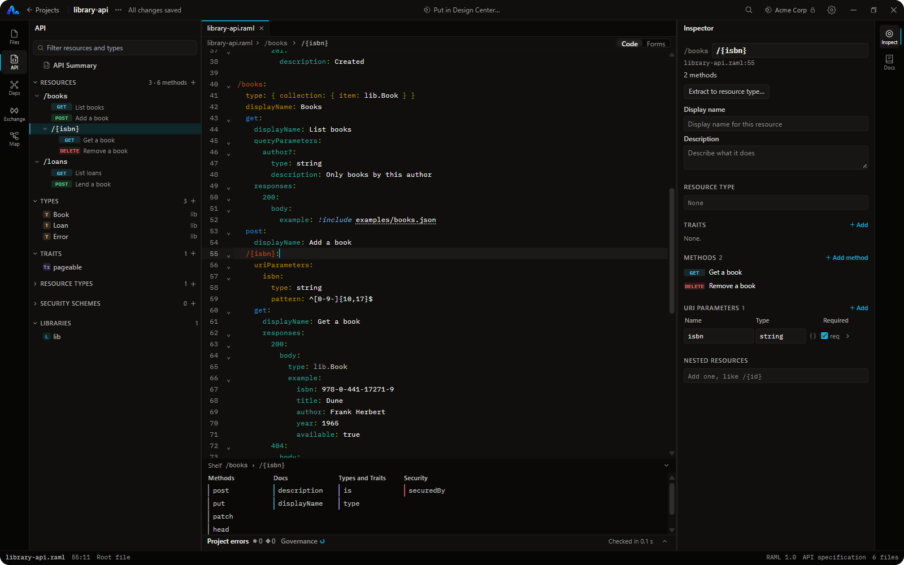
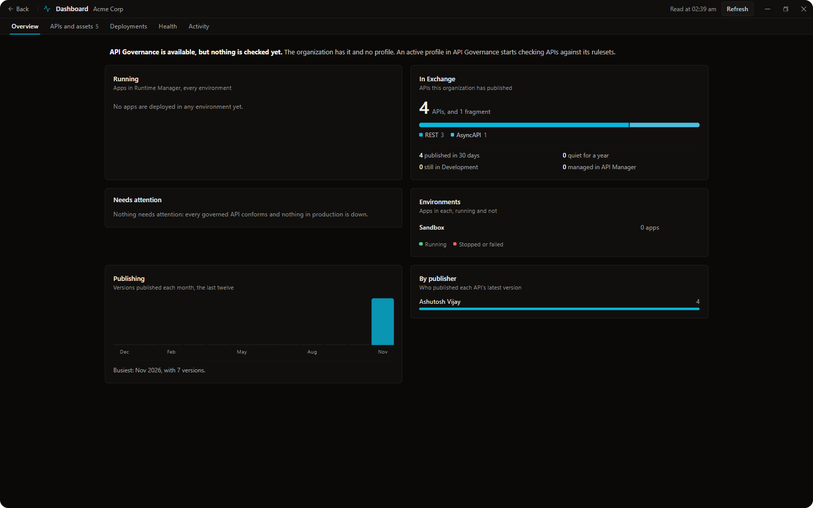
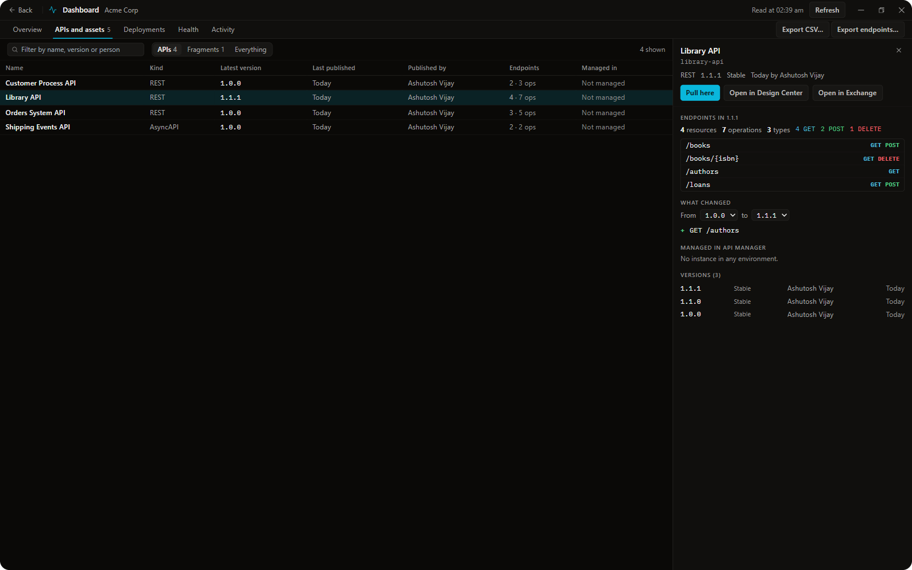
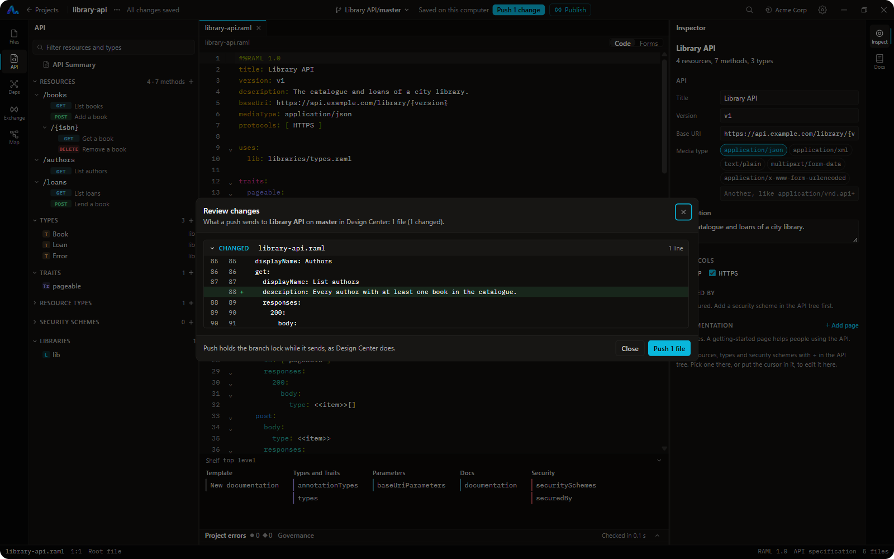
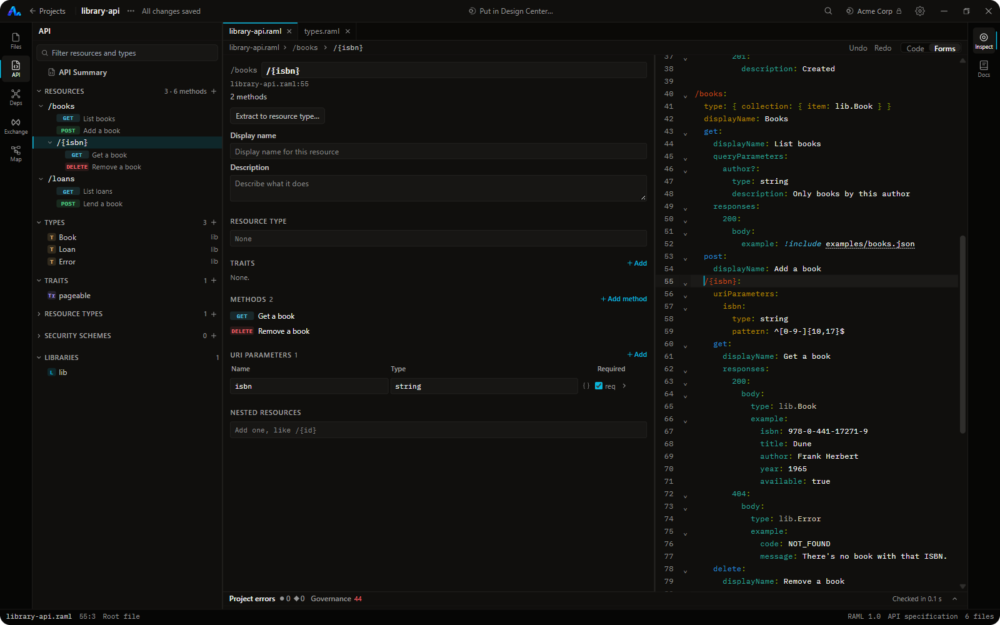
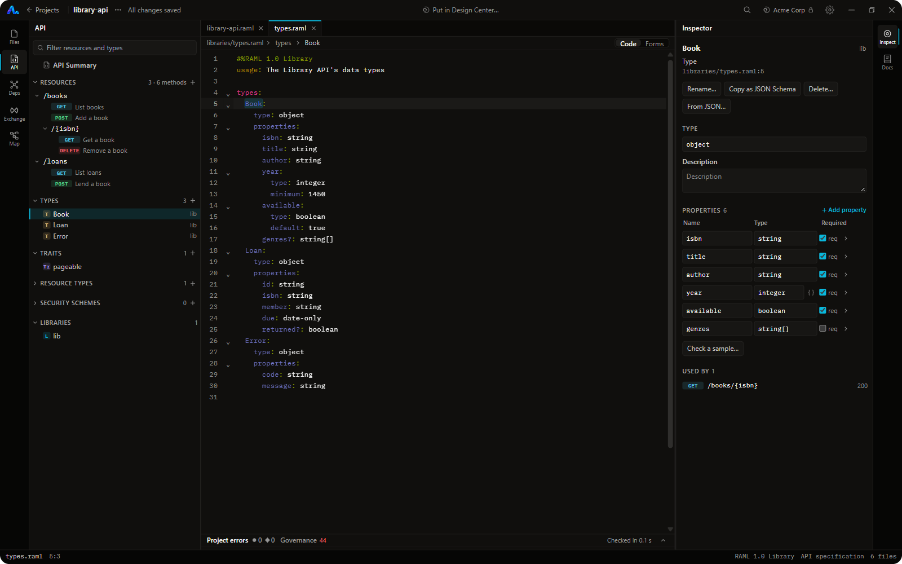
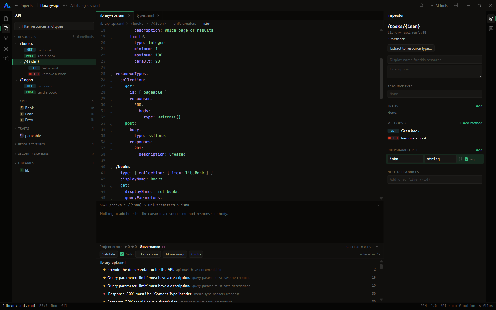
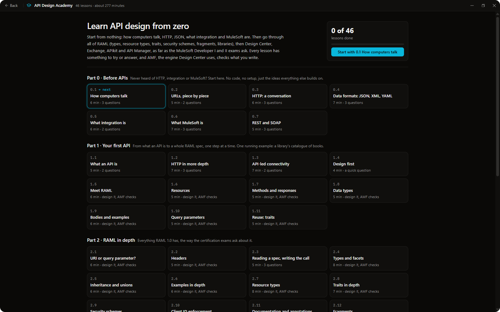

# Design Studio for MuleSoft

**Design Center, minus the waiting.** A fast, free, open-source API designer for MuleSoft Anypoint: RAML, OpenAPI and AsyncAPI, on your desktop or inside VS Code.

> **TL;DR:** Design Studio for MuleSoft is a free, open-source (MIT) API designer for MuleSoft Anypoint Platform, as a VS Code extension and a desktop app for Windows, macOS and Linux. It edits RAML 1.0, OpenAPI (OAS 2.0, 3.0, 3.1) and AsyncAPI 2.x specs with live validation by AMF, the engine Anypoint Design Center uses, keeps visual forms and code in step both ways, and pulls, pushes and publishes with Design Center and Exchange. It adds what Design Center doesn't have: instant checks on big specs, offline work, refactorings, a review of every change before you push, a local mock, governance in the editor, an organization dashboard with an Excel export of every endpoint, 40 AI tools over MCP, and a 46-lesson course for the MuleSoft Developer I and II certifications. No account, no telemetry.

**[Website](https://ashutosh-vijay.dev/design-studio/)** | **[VS Code Marketplace](https://marketplace.visualstudio.com/items?itemName=ashutosh-vijay.design-studio-mulesoft)** | **[Releases](https://github.com/Ashutosh-Vijay/design-studio/releases)** | **[Questions](#questions-people-ask)**

`0.1 s checks after every edit` · `RAML · OAS 3.1 · AsyncAPI` · `7 Anypoint clouds` · `40 AI tools` · `46 lessons` · `MIT`

> **Beta.** It does real work today. Tell us what you hit.

---

## Why it exists

If you design APIs in Anypoint Design Center, you know the moment: the spec passes a couple of thousand lines, suggestions start to crawl, and everyone falls back to copying an endpoint, pasting it and editing by hand. Every check is a wait, every big project a crawl, and a train with no wifi means no work at all.

Design Studio is Design Center on your own computer, with the waiting taken out. Same layout, same words (Root file, Project errors, Exchange dependencies, Publish), same projects, branches and locks, so switching costs nothing. Then it goes further: forms that never rewrite your file, refactorings across files, a review of every line before you push, governance and a mock right in the editor, and a dashboard of your whole organization.

## Highlights

- **Checks as fast as you type.** A 2,000-line RAML spec with 40 files opens in seconds. After each edit a quick read takes about a tenth of a second, and AMF's full check runs in the background, with the same messages as Design Center.
- **Forms and code, both ways.** Build a whole API from forms, as with Design Center's Guide me through it, or edit any spec with them. A form changes only the lines it must, so it never reformats your file.
- **See what you push.** Review changes shows every line a push will send to Design Center before it goes. The push holds the branch lock, and a merge shows both sides when you and Design Center changed the same lines.
- **Your organization at a glance.** The Dashboard shows every API in Exchange with its versions, endpoints and what changed between them, API Governance conformance, what's deployed where, health checks, and an Excel export of every endpoint. It only reads.
- **Works offline.** Pull once, then work anywhere. You only need a connection to pull, push and publish.
- **Built for AI agents.** 40 tools over MCP let Copilot, Claude Code and Cursor open projects, edit specs, run AMF's checks and try the mock while you watch. Changes in Design Center and Exchange stay off until you allow them.
- **Learn it properly.** The API Design Academy goes from how computers talk to all of RAML, Design Center, Exchange, APIkit and API Manager, with exam-style practice for the MuleSoft Developer I and II certifications. AMF checks every answer.

---

## Preview

*The Dashboard: every API in Exchange, governance, what runs where, and who published what*

*An API's endpoints, its versions and what changed between them, with Pull here and Open in Design Center*

*Review changes: every line a push sends to Design Center, before it goes*

*The forms in front, as with Design Center's Guide me through it, and the code beside them, changed one line at a time*

*A type from a library as a form: properties, types, required, and every place it's used, from AMF's own links*

*Documentation for the API as AMF resolves it, and Try it on a local mock that answers with the spec's examples and Design Center's MS2 headers*

*Governance: the rulesets the API depends on (here, Anypoint Best Practices), checked in the background, each finding linked to its line*

*The API map: resources, traits, resource types, types and files, with what uses what, and Show unused*

*API Design Academy: 46 short lessons, from HTTP to the MuleSoft certifications*

*The same in the Paper (light) theme*

---

## Everything it does

- **Editor.** Instant suggestions for types (library types under their `uses:` alias), traits, resource types and `!include` paths, plus Design Center's shelf under the editor: click and it's inserted at the right indentation. RAML, OAS and AsyncAPI in Design Center's colours, go to definition, find references, symbols, and a command palette.
- **Forms.** Resources, methods, types, parameters, bodies, responses and security schemes for RAML 1.0, OAS 3.0 and 3.1 (YAML and JSON), and servers, channels, messages and schemas for AsyncAPI 2.x. Pick one media type or several. Create a missing example file from its type, or a type from pasted JSON. Paste a real body into any type's Check a sample and AMF's payload validator says exactly what doesn't match.
- **Starters.** A secured starter for RAML, OAS 3.0 and 3.1 and AsyncAPI: HTTPS only, OAuth 2.0 on every call, error and rate-limit responses and correlation ids, clean on MuleSoft's best-practice and OWASP rulesets.
- **Refactorings.** Rename a type, trait or resource type everywhere, extract to a library, move a type to a library, extract a trait or resource type, delete with cascade. Renaming a file updates every `!include` and `uses:`.
- **Design Center sync.** Sign in, list your projects, pull one or all, put a project made on your computer into Design Center, review changes, push with the branch lock, Lock while I edit, branches, and merge with conflict help.
- **Exchange.** Publish with a suggested version (from what changed since the last one), Development or Stable, manage dependencies, Import from Exchange, and see what changed in every version.
- **Governance.** Rulesets from Exchange, checked after every full check, each finding linked to its line, with rules you can switch off per project.
- **Documentation, mock and map.** The API as documentation, Try it on a local mock that answers JSON, XML, YAML and forms the way the spec says, and a map of what uses what.
- **Dashboard.** Every asset in Exchange with every version and who published it, each API's endpoints and what changed between versions (a breaking change published as a minor version is flagged), API Governance conformance with each failing rule, what's managed and deployed in each environment, health checks of the addresses you choose with your own methods, headers and success codes, CSV exports, and an Excel export of every endpoint (a plain list, or a workbook with a dashboard, a linked index and a sheet per API). Each part shows only what your Anypoint permissions allow.
- **Design Center's file actions.** Set as root file, Rename, Duplicate (a copy, or RAML to OAS through AMF), Delete to the trash, Download as zip, Import.
- **Made to fit.** Dusk and Paper themes, accents, editor and interface fonts, text sizes, and in VS Code it can follow your VS Code theme.

## Install

- **VS Code:** install **Design Studio for MuleSoft** from the Marketplace, then run **Design Studio: Open**, or right-click a project folder or a `.raml` file and pick **Open in Design Studio**. The AMF engine and a small Java runtime are included, so there's nothing else to install, which suits locked-down work machines.
- **Windows, macOS, Linux:** the desktop app follows the VS Code beta, on the [Releases](https://github.com/Ashutosh-Vijay/design-studio/releases) page: an installer, a portable zip, and the installer zipped for proxies that block `.exe`. It updates itself quietly.

## Signing in to Anypoint

- **Sign in with Anypoint** opens your browser and comes back to this computer. It works in the US, EU, Canada, UK, Japan, India and Australia clouds. In US Government, use your own Connected App.
- **Your own Connected App** works in every Anypoint cloud, with a browser sign-in or client credentials; its secret goes to the system keychain.
- **Connections start read only.** Nothing in Design Center or Exchange changes until you turn read only off in Settings.

## AI tools

In VS Code, Copilot's agent mode can use Design Studio's tools directly: pick them in its tools list, nothing to set up. For other agents (Claude Code, Cursor, Claude Desktop), open Settings, AI tools, and **Start**: the panel shows the one-line setup for each. That server listens on `127.0.0.1` only.

## Questions people ask

**Is there a RAML editor for VS Code?**
Yes. Design Studio for MuleSoft runs inside VS Code with live AMF validation, autocomplete for types, traits and `!include` paths, forms for every part of the spec, and Design Center sync. Install it from the Marketplace and run **Design Studio: Open**.

**Can I work on Anypoint Design Center projects offline or on my desktop?**
Yes. Pull a Design Center project once (or open a folder or a Design Center zip) and edit it with no connection. Push and publish when you're back online; the push holds Design Center's branch lock, as Design Center does.

**Why is Design Center slow on big specs, and what can I do?**
Design Center's suggestions and checks slow down as a spec grows. Design Studio parses on your own computer with a warm AMF engine: a quick read after each edit in a fraction of a second and the full check in the background, even on a 2,000-line spec with 40 files.

**How is it different from Anypoint Code Builder?**
Anypoint Code Builder is MuleSoft's IDE for building Mule apps and designing specs. Design Studio does one job: designing API specs the way Design Center does, with the same layout and words, plus forms, refactorings, governance, a local mock, an organization Dashboard and an Academy. They work side by side.

**Does it support OpenAPI and AsyncAPI, not just RAML?**
Yes: RAML 1.0, OAS 2.0, 3.0 and 3.1 in YAML or JSON, AsyncAPI 2.x, and RAML fragments. Duplicate As converts between RAML and OAS through AMF.

**Can I see every API in my Anypoint organization in one place?**
Yes, the Dashboard: every Exchange asset with versions and endpoints, API Governance conformance, what's managed and deployed in each environment, a health check, and an Excel export of every endpoint. It only reads.

**Can I see what a push will change before it goes to Design Center?**
Yes. Push opens Review changes first: every file it will send, with each added and removed line, and the Push button inside.

**Does it send my specs anywhere?**
No. No telemetry, no analytics, no account of its own. Specs leave your computer only when you push or publish to your own Anypoint organization.

**Which Anypoint regions does it work with?**
Sign in with Anypoint works in the US, EU, Canada, UK, Japan, India and Australia clouds. Your own Connected App works in every cloud, US Government included.

**Can AI agents use it?**
Yes. It has 40 tools over MCP, so Copilot, Claude Code, Cursor and others can open projects, edit specs, run AMF's checks and governance, and try the mock while you watch. Changes in Design Center and Exchange stay off until you allow them.

**Is it free?**
Yes, MIT licensed. It's independent and not made by MuleSoft or Salesforce.

## Privacy and security

No telemetry, no analytics, no accounts of its own. Your specs stay on your computer unless you push or publish them to your own Anypoint organization. [PRIVACY.md](PRIVACY.md) is the short version; [SECURITY.md](SECURITY.md) lists every network connection and port, for reviewers.

## Contributing

Bug reports and ideas are welcome: [open an issue](https://github.com/Ashutosh-Vijay/design-studio/issues). Pull requests too; [CONTRIBUTING.md](CONTRIBUTING.md) says how to build it and what to check first.

## Build from source

- **Desktop:** Java 17 or later and Maven, Node 22, Rust. `mvn package` in `amf-server/`, then `npm install` and `npm run tauri dev`.
- **VS Code:** `npm run build:vscode`, then see [vscode-extension/DEVELOPMENT.md](vscode-extension/DEVELOPMENT.md).
- **Releasing:** [docs/RELEASING.md](docs/RELEASING.md).

How it's built, and the proof tests behind each choice, are in [docs/ARCHITECTURE.md](docs/ARCHITECTURE.md).

## Credits

AMF is MuleSoft's, under the Apache License 2.0. Design Studio is not affiliated with, endorsed by or sponsored by MuleSoft or Salesforce. Anypoint, Design Center, Exchange and MuleSoft are trademarks of Salesforce, Inc. See [NOTICE](NOTICE).

Made by [Ashutosh Vijay](https://ashutosh-vijay.dev/), who also makes [DataWeave Studio](https://github.com/Ashutosh-Vijay/DataWeave-Studio).
