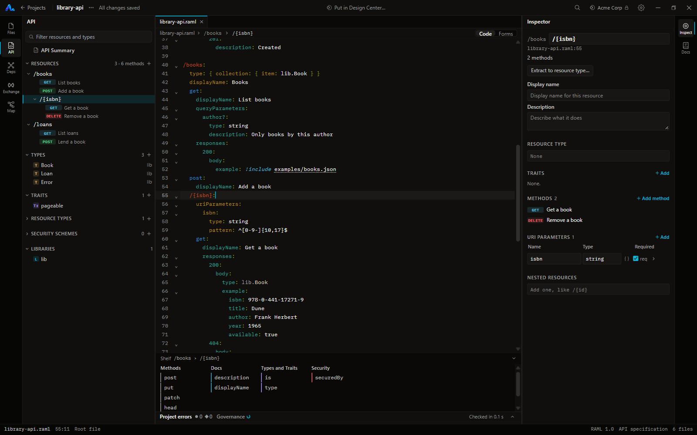
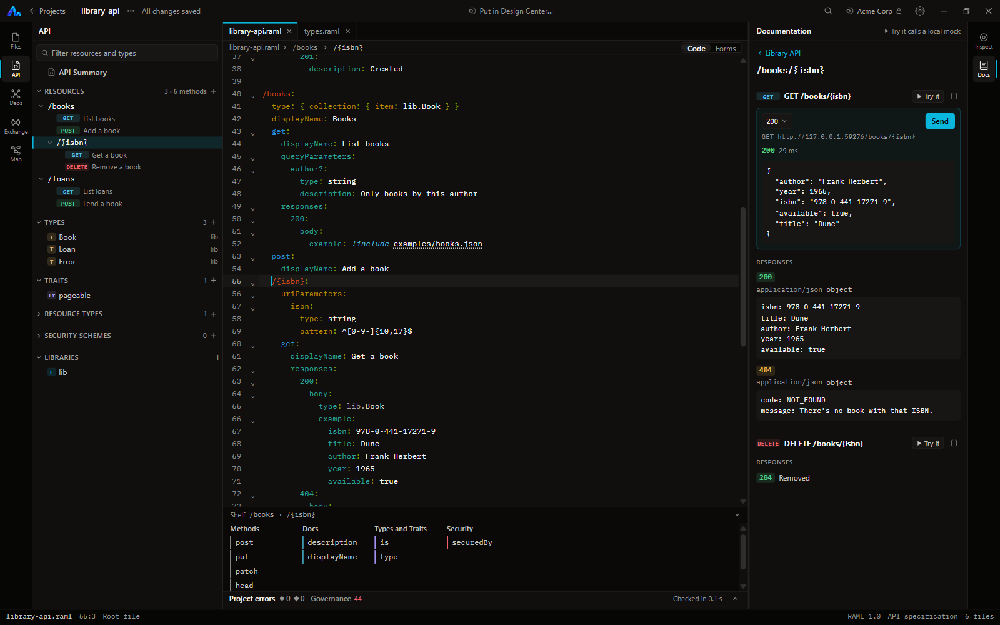
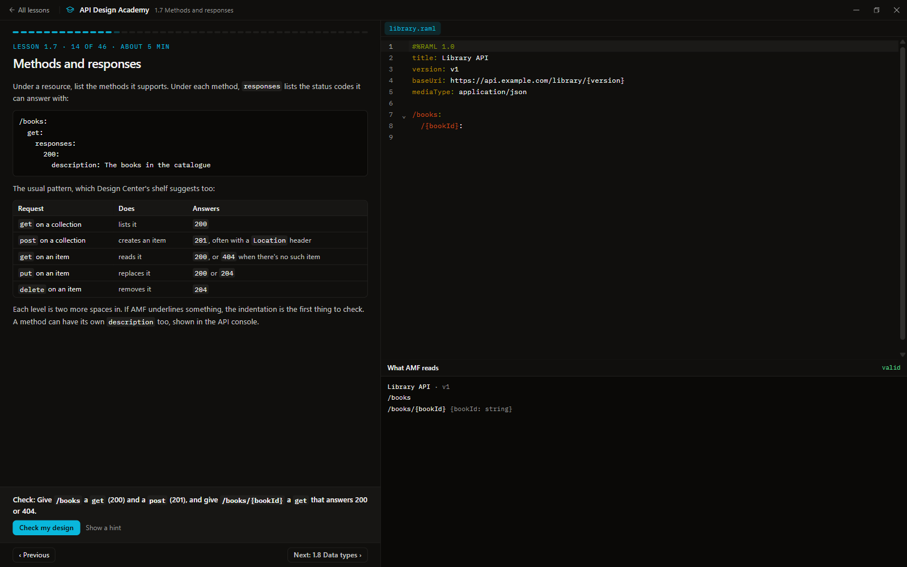

# Design Studio for MuleSoft (BETA)

**Design and edit MuleSoft Anypoint API specs (RAML 1.0, OpenAPI 3.0 and 3.1, AsyncAPI 2.x) inside VS Code, with live AMF validation and two-way sync with Anypoint Design Center and Exchange.** Free and open source (MIT).

Big specs open in seconds, and every edit is checked as you type by AMF, the same engine Design Center uses. It works the way Design Center does, with the same words (Root file, Project errors, Exchange dependencies, Publish), so there's nothing new to learn.

> **Beta.** Tell us what you hit.

## What you get

- **An editor that keeps up**: instant suggestions for types, traits and `!include` paths, the API tree, and Design Center's shelf under the editor.
- **Forms and code in step**: build an API from forms (like Design Center's Guide me through it) or from code, and switch any time; a form changes only the lines it must.
- **Refactorings**: rename a type everywhere, find references, extract to a library, delete with cascade.
- **Design Center sync**: sign in, pull projects, push with the branch lock, branches, and merge with conflict help.
- **Exchange**: publish with a suggested version, add and update dependencies, and see what changed since the last version.
- **Governance**: check your API against the rulesets it depends on.
- **A local mock**: try every method with Design Center's MS2 headers, unsaved edits included.
- **Dashboard**: every API in your Anypoint organization in one place: versions and endpoints, what changed between versions, API Governance conformance, what's managed and deployed in each environment, a health check of the addresses you choose, and an Excel export of every endpoint. It only reads.
- **AI tools**: Copilot's agent mode can use Design Studio's tools directly, with nothing to set up: open projects, edit specs, run AMF's checks and governance, try the mock. You watch every change happen, and tools that change something ask first. Claude Code, Cursor and other agents can connect too (Settings, AI tools).
- **API Design Academy**: 46 lessons, from how computers talk (HTTP, JSON, integration, MuleSoft) to all of RAML, Design Center, Exchange, APIkit and API Manager, with exam-style practice for the MuleSoft Developer I and II certifications, checked by AMF.

- **Made to fit**: editor and interface fonts, text sizes, Design Center or Design Studio colours, and it can follow your VS Code theme.

## Getting started

- Command Palette: **Design Studio: Open**.
- Explorer: right-click a project folder or a `.raml` file, then **Open in Design Studio**.
- New to API design? **Design Studio: API Design Academy**.

Everything is included: the AMF engine and a small Java runtime, so you don't need Java installed. Your specs stay on your computer; you only sign in to pull, push and publish.

## Signing in

**Sign in with Anypoint** opens your browser and comes back to VS Code on this computer (localhost ports 8765 to 8768). It works in the US and India Anypoint clouds today; in every other cloud, use your own Connected App. Connections start read only, so nothing in Design Center changes until you turn that off in Settings.

Remote windows (SSH, WSL, dev containers, Codespaces) aren't supported in this beta: run VS Code locally.

## Questions

**Does it work offline?** Yes. Open a folder or a Design Center zip, or pull a project once; you only need a connection to pull, push and publish.

**Is it the same as Anypoint Code Builder?** No. Code Builder is MuleSoft's IDE for Mule apps. Design Studio is for designing API specs the way Design Center does, with forms, refactorings, governance, a local mock, a Dashboard and an Academy. They work side by side.

**Does it send my specs anywhere?** No. No telemetry or analytics. Specs leave your computer only when you push or publish to your own Anypoint organization.

**Is it made by MuleSoft?** No. It's independent, and not affiliated with MuleSoft or Salesforce. A desktop app with the same features follows the beta. Source and issues: [GitHub](https://github.com/Ashutosh-Vijay/design-studio).
